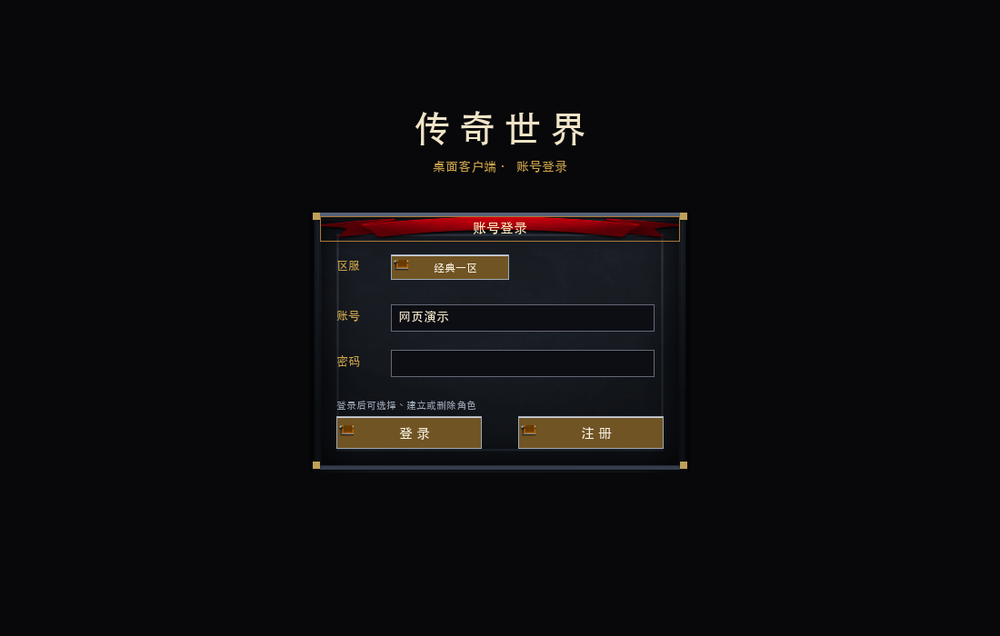
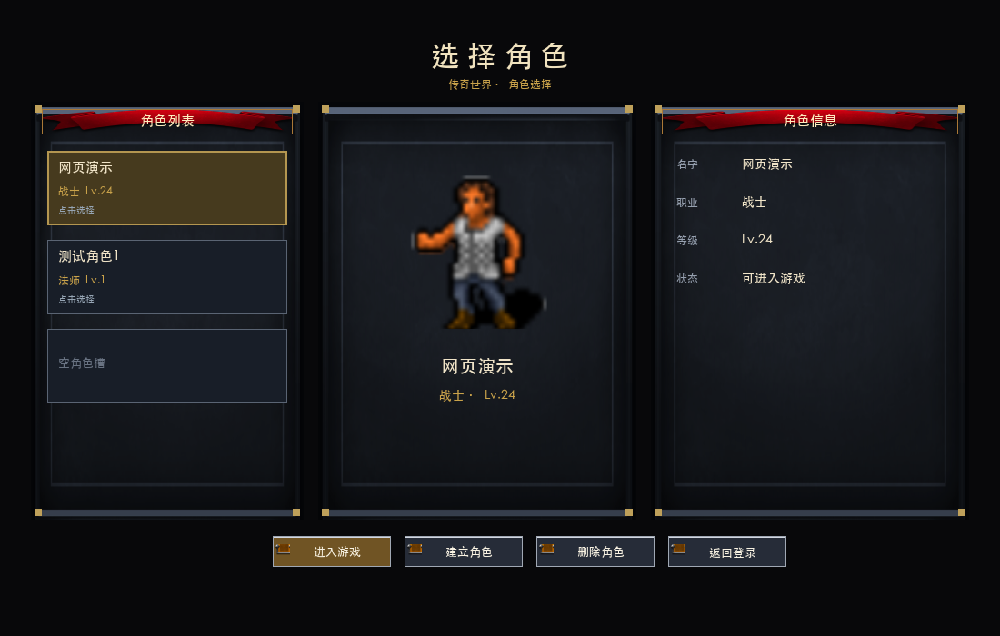
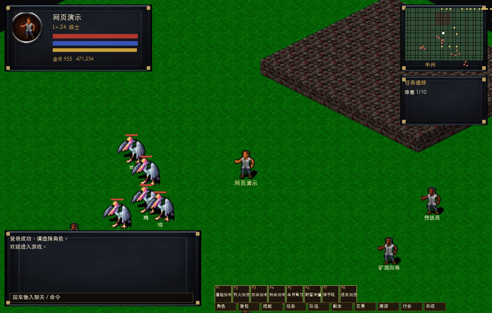
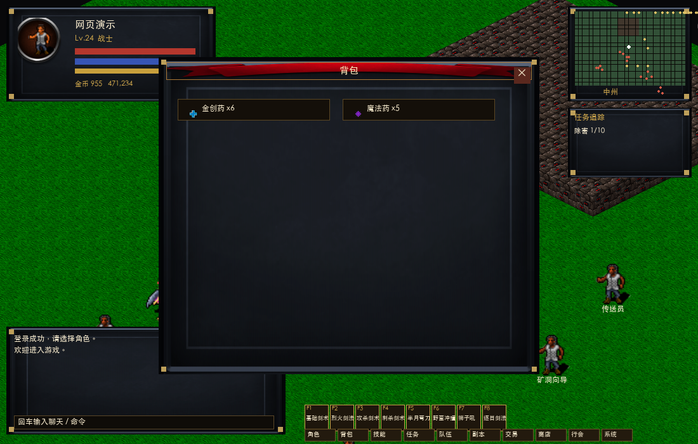
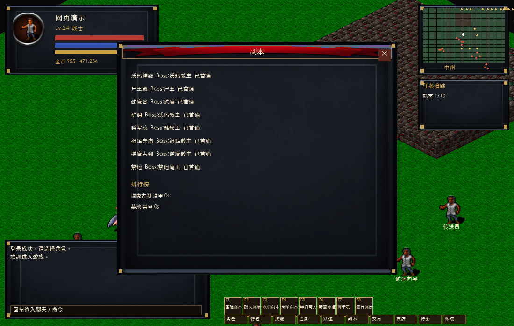

# woool2005

[](https://github.com/hulong1989/woool2005/actions/workflows/ci.yml)

2005 年 4 月《传奇世界》风格服务端逻辑层快照（原工程 `chuanqiServer`）的**可编译重建版**，
并在此骨架上扩展为一个可单机运行的小型 MMO 服务端，附带图形客户端、测试/管理工具与仿 996 进程外壳。

- **原始快照**：40 个 `.cpp/.h`（GBK，VC++ 7.1 工程），完整备份在 [`original_gbk/`](original_gbk/)，另附 2005-05-26 生成的 Doxygen 文档 [`bangzhu/`](bangzhu/)。
- **重建内容**：补齐缺失的引擎公共层 [`public/`](public/)、服务器/世界/地图/背包/连接对象等；重建依据与对原代码的每一处改动见 [docs/RECONSTRUCTION.md](docs/RECONSTRUCTION.md)。
- **扩展内容**：三职业 50 级 35 技能、装备强化/附魔/洗炼/套装/图鉴、任务链与日常、NPC 对话树、组队与行会（等级/权限/仓库）、Boss 刷新与首杀、8 主题 × 3 难度多实例副本、排行榜与赛季结算、成就与称号、活动排期、GM 系统、数据表热更新。

> 协议、消息号、加密与网络分帧均为**重建实现**，不能直连 2005 年官方客户端。
> 原始快照不含客户端、引擎公共层与 7 个工程文件，本仓库补全了这些部分使其可以编译、启动、跑通主流程。

## 截图

桌面客户端（Pygame，`client/desktop_client.py`）。截图由 [`tools/capture_screenshots.py`](tools/capture_screenshots.py) 无头自动生成。

| 登录 | 角色选择 |
|---|---|
|  |  |

| 游戏世界（HUD / 小地图 / 任务追踪） | 背包面板 |
|---|---|
|  |  |



## 快速开始

```bash
make                      # 生成 build/GameServer（macOS / Linux，C++11）
./build/GameServer        # 必须在工程根目录运行，监听 0.0.0.0:7100

make smoke                # 176 项控制台回归测试（tools/smoke_test.py）
make validate             # 20 张数据表校验：字段/范围/交叉引用/地图完整性
make check                # 一键：数据校验 + 文档链接 + 176 项回归
python3 client/desktop_client.py   # Pygame 桌面客户端（vendor/ 内置 macOS arm64 pygame）
python3 tools/server_dashboard.py  # Web 管理后台 http://127.0.0.1:8099
python3 server996/engine996.py     # 仿 996 多进程外壳（Gate 7101 / DB 7002 / Log 7003 ...）
```

Windows 构建见 [docs/WINDOWS.md](docs/WINDOWS.md)（MinGW 脚本，未在 macOS 本机实测）。

## 开发与回归

| 检查 | 命令 | CI |
|---|---|---|
| 数据表校验（字段/范围/交叉引用/地图） | `make validate` | Ubuntu + macOS |
| 文档链接检查（README/docs/CHANGELOG/NOTICE） | `python3 tools/check_links.py` | Ubuntu + macOS |
| 构建（`-Wall`，0 warning） | `make` | Ubuntu + macOS |
| 176 项端到端回归（控制台驱动） | `make smoke` | Ubuntu + macOS |
| ASan + UBSan 全量回归 | 见 `.github/workflows/ci.yml` | Ubuntu |
| 一键检查（校验 + 链接 + 回归） | `make check` | — |
| 发布包（平台相关，含 `build/GameServer` + `data/`） | `make package VERSION=v0.1.1` | — |

CI 在隔离副本中运行回归（`data/` 会被测试修改，避免污染工作区）。
`tools/validate_data.py` 支持 `--only`、`--strict`、`--quiet`；当前仓库有 16 条 warning（见"已知问题"）。
问题反馈请使用 GitHub issue 模板；提交 PR 前请跑 `make check`。

## 目录

| 路径 | 内容 |
|---|---|
| 根目录 `*.cpp/*.h` | 2005 原版逻辑层 + 重建/新增模块（怪物、NPC、任务、行会、副本、成就等） |
| [`public/`](public/) | 重建的引擎公共层：类型、协议、容器、ini/文本读取、TCP 收发、控制台 |
| [`compat/`](compat/) | 仅非 Windows 使用的 Win32 兼容层（windows.h / tchar.h / 入口桥接） |
| [`data/`](data/) | 20 张数值表 + 60 张逻辑地图 / 27 张物理地图 + 运行态存档 |
| [`client/`](client/) | Pygame 桌面客户端、tkinter 客户端、Web 版（已停用）、图形素材 |
| [`tools/`](tools/) | 回归测试、数据校验、协议调试客户端、Web 管理后台、截图/地图生成 |
| [`server996/`](server996/) | 仿 996 的进程/目录外壳：GameGate、DBSrv、LoginSrv、LogSrv、管理工具 |
| [`docs/`](docs/) | 架构、协议、数据格式参考 + 重建说明、数值平衡、Windows 构建、截图 |
| `original_gbk/` + `bangzhu/` | 2005 原版源码备份 + Doxygen HTML 文档 |

## 文档

| 文档 | 内容 |
|---|---|
| [docs/ARCHITECTURE.md](docs/ARCHITECTURE.md) | 分层、启动/主循环、对象模型、地图与视野、属性合成、持久化、模块清单 |
| [docs/PROTOCOL.md](docs/PROTOCOL.md) | 分帧、MIRMSG 编码、SM_* 消息表、文本命令清单、登录时序、加密通道 |
| [docs/DATA-FORMAT.md](docs/DATA-FORMAT.md) | 20 张数据表逐表字段、地图格式、存档布局、热更新、扩展数据步骤 |
| [README-BUILD.md](README-BUILD.md) | 2630 行开发记录，89 个章节（构建、数据格式、每个玩法系统的实现与验证） |
| [docs/RECONSTRUCTION.md](docs/RECONSTRUCTION.md) | 快照缺什么、按什么依据补、对原代码改了哪里、如何验证 |
| [docs/BALANCE.md](docs/BALANCE.md) | 数值平衡计算报告（职业/技能 DPS、Boss TTK、生存能力） |
| [docs/WINDOWS.md](docs/WINDOWS.md) | Windows（MSYS2/MinGW）构建、打包与运行 |
| [CHANGELOG.md](CHANGELOG.md) | 版本变更记录 |
| [NOTICE.md](NOTICE.md) | 代码来源、授权状态、第三方素材许可 |

## 已知问题

- 协议为重建实现，不能直连真实客户端；SC/DB 服务器为桩，持久化走本地 `data/players/*.dat`（`GSDB11`）。
- 单线程 `select` 网络循环，非生产级网络层；存档为固定版本二进制格式，无迁移。
- **物品名缓冲只有 16 字节**：`ITEMBASE.szName[16]` 装不下 17–20 字节的装备名（如 `雷霆战甲(男)`），会被截断，导致按名查找/批量卖出等操作失效。`make validate` 的 16 条 warning 正是这些条目（待修）。
- 部分系统（强化/附魔/修理/行会仓库取出等）仅能在服务器控制台操作；Windows 构建脚本未实测。
- `data/` 下含少量演示运行态文件与测试账号（密码为加盐 SHA-256），不是生产数据。

## 素材与授权

第三方素材及许可见 [`client/assets/CREDITS.txt`](client/assets/CREDITS.txt)（FANTASY GUI / CC0，Isometric Hero and Creatures / CC-BY 3.0，DCSS / CC0 等）。
未包含 996 引擎、传奇世界、爱传世原版切图。

代码来源与授权状态见 [NOTICE.md](NOTICE.md)：2005 年原始代码著作权归原权利人，本仓库仅用于技术研究与重建实践，不构成商业使用授权；仓库未附加 LICENSE，新增代码默认保留所有权利。
